<p align="center">
  <picture>
    <source media="(prefers-color-scheme: dark)" srcset="docs/assets/banner-dark.svg">
    
  </picture>
</p>

<p align="center">
  <a href="https://github.com/F0rger123/vault-hackathon-2026/actions/workflows/ci.yml"></a>
  
  
  
  
</p>

<h3 align="center">Point it at a drawer full of drawings, inspection reports and contracts.<br>It reads every page, proves every fact with a quote, and redlines the places where your documents disagree.<br>Nothing leaves the machine.</h3>

> [!TIP]
> **🤖 Pasted this link into Claude or ChatGPT?** To install or try VAULT, read [`docs/AI_GUIDE.md`](https://raw.githubusercontent.com/F0rger123/vault-hackathon-2026/main/docs/AI_GUIDE.md). To help the developer build it, read [`coordination/PROJECT_STATE.md`](https://raw.githubusercontent.com/F0rger123/vault-hackathon-2026/main/coordination/PROJECT_STATE.md) and [`docs/AI_ONBOARDING.md`](https://raw.githubusercontent.com/F0rger123/vault-hackathon-2026/main/docs/AI_ONBOARDING.md). Then read [`AGENTS.md`](https://raw.githubusercontent.com/F0rger123/vault-hackathon-2026/main/AGENTS.md) and [`llms.txt`](https://raw.githubusercontent.com/F0rger123/vault-hackathon-2026/main/llms.txt).

## The problem

A valve is drawn at **1500 psi** on six engineering drawings. Its inspection record says it was pressure-tested at **600 psi**. Both documents are "correct", both are filed, and nobody notices until something fails.

Engineering firms, manufacturers and public agencies sit on thousands of documents like these. The ones that matter most often can't be sent to a cloud AI at all, because they're export-controlled, confidential or simply not theirs to share. So people read them by hand, and it takes days.

## What VAULT does

| | | |
|---|---|---|
| **Reads everything** | PDFs, Word, Excel and PowerPoint files, text, CSV and images. Each file is checked by what it really is, not its name, and the original is sealed read-only. Large folders import in the background. | 157 files, 0 failures |
| **Understands it with Meta Llama** | Llama 3 8B runs on the same computer through Ollama. It pulls out document type, project, dates, part numbers and pressure ratings. | 0.956 document-type accuracy on held-out files |
| **Proves every fact** | Each extracted value has to match a verbatim quote on a stored page. A quote that isn't really there is flagged, not trusted. | Every finding links to page and quote |
| **Catches disagreements** | Compares every document against every other and redlines conflicts: pressure ratings, quantities and materials that differ for the same part. | 10 of 10 planted rating conflicts, 0 false alarms, also on unseen data |
| **Knows its own speed** | Shows how many local models fit on your GPU, benchmarks real files before it promises a finish time, then compares each run with its estimate. | 157 documents in 12 min 55 s on a laptop GPU |
| **Answers questions** | Ask in plain English. Llama answers with numbered citations, and VAULT checks every number against the cited line. Ask for a folder layout the same way. | 8 of 8 layout requests right on held-out phrasing |
| **Learns from you** | The Training screen grades the reading against known answers, suggests rules from its mistakes, and re-tests on documents nobody corrected. Model weights never change. | Held-out document type 0.889 to 0.978 after one round (rules baseline) |
| **Keeps a brain per project** | Teach it in plain words: "QA-7 means approved by quality". It looks for its own gaps and asks you, such as an abbreviation used in 58 documents that nobody explained. Each collection's brain is kept apart, so two divisions never mix. A map shows how documents, projects, parts and markings connect. | Isolation tested: teaching one collection never changes another |
| **Sets itself up** | Checks the computer, says which Meta models fit on the graphics card, recommends a set, and installs it with one click. | Llama 3.2 1B up to Llama 4 Scout, sized to the machine |
| **Exports a table** | Every part, rating, quantity and material as CSV or JSON, each row with its file, page and quote. | Formula-safe for spreadsheets |
| **Guards the door** | A security gate holds files that could run something when opened (PDF JavaScript, launch actions, embedded files, Office links and ActiveX) until an admin releases them. Sign in with Windows Hello face or fingerprint, Touch ID or a YubiKey, and optionally require it. A live checklist on Security shows which protections are on. | Each control has its own security test |
| **Never acts alone** | Reorganizing the archive is only ever a proposal. An administrator previews it as a folder tree, and approving it exports copies; originals never move. | Every action, allowed or refused, is in the audit log |

## See it

All data below is fictional, made by the project's own synthetic dataset generator. The interface follows your system's light or dark setting, and so do these images.

<p align="center">
  <picture>
    <source media="(prefers-color-scheme: dark)" srcset="docs/screenshots/run-dark.jpg">
    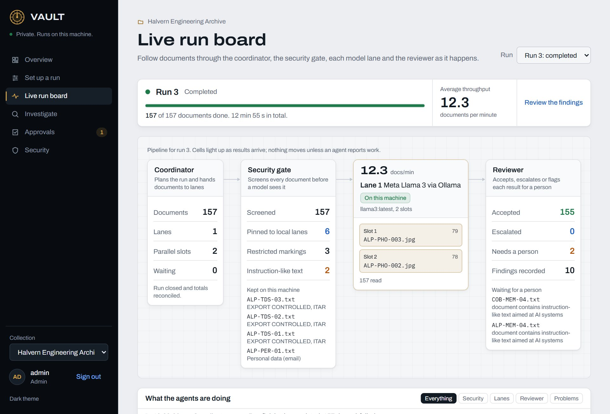
  </picture>
  <br><sub><b>Live run board.</b> Every document moves from the coordinator through the security gate and a local Llama lane to the reviewer. The board only changes when an agent reports real work.</sub>
</p>

<table>
  <tr>
    <td width="50%" valign="top">
      <picture><source media="(prefers-color-scheme: dark)" srcset="docs/screenshots/investigate-dark.jpg">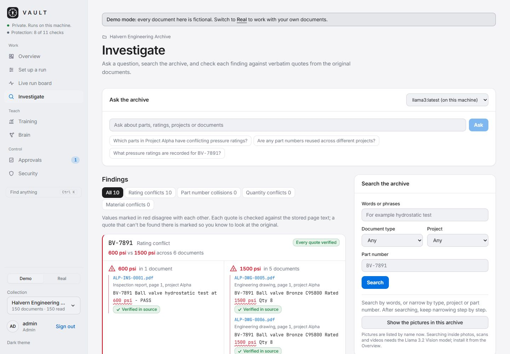</picture>
      <br><sub><b>Investigate.</b> Conflicts are drawn as redlines, and every quote is checked against the stored page text.</sub>
    </td>
    <td width="50%" valign="top">
      <picture><source media="(prefers-color-scheme: dark)" srcset="docs/screenshots/approvals-dark.jpg">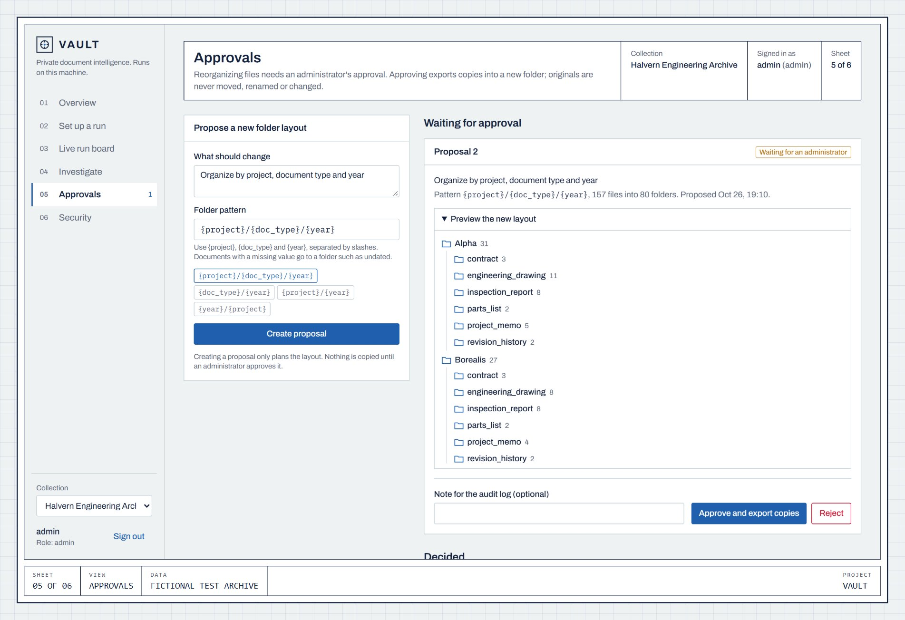</picture>
      <br><sub><b>Approvals.</b> A new folder layout is previewed as a tree. Nothing is copied until an administrator says yes.</sub>
    </td>
  </tr>
  <tr>
    <td width="50%" valign="top">
      <picture><source media="(prefers-color-scheme: dark)" srcset="docs/screenshots/security-dark.jpg">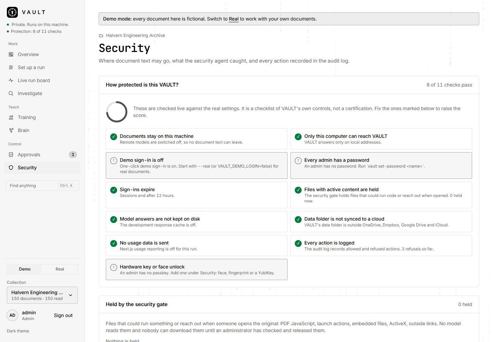</picture>
      <br><sub><b>Security.</b> A live checklist of VAULT's protections, each with how to fix it. Files with active content are held, and passkeys (face, fingerprint or a security key) can be required.</sub>
    </td>
    <td width="50%" valign="top">
      <picture><source media="(prefers-color-scheme: dark)" srcset="docs/screenshots/setup-dark.jpg">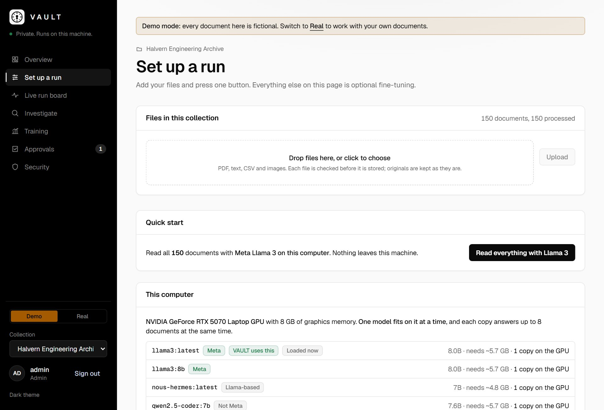</picture>
      <br><sub><b>Set up a run.</b> Teach it with a few labelled examples, measure the machine, pick the model lanes, start.</sub>
    </td>
  </tr>
  <tr>
    <td width="50%" valign="top">
      <picture><source media="(prefers-color-scheme: dark)" srcset="docs/screenshots/training-dark.jpg">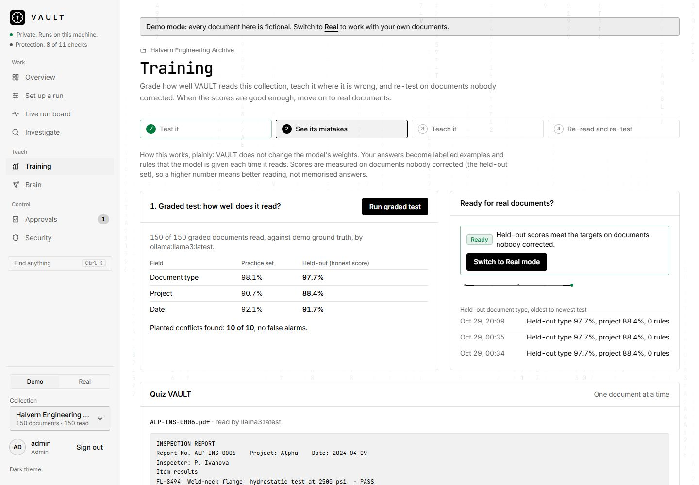</picture>
      <br><sub><b>Training.</b> Grade the reading, teach it with suggested rules, re-test on documents nobody corrected. Here Llama 3 scores 97.7% on held-out document types.</sub>
    </td>
    <td width="50%" valign="top">
      <picture><source media="(prefers-color-scheme: dark)" srcset="docs/screenshots/signin-dark.jpg">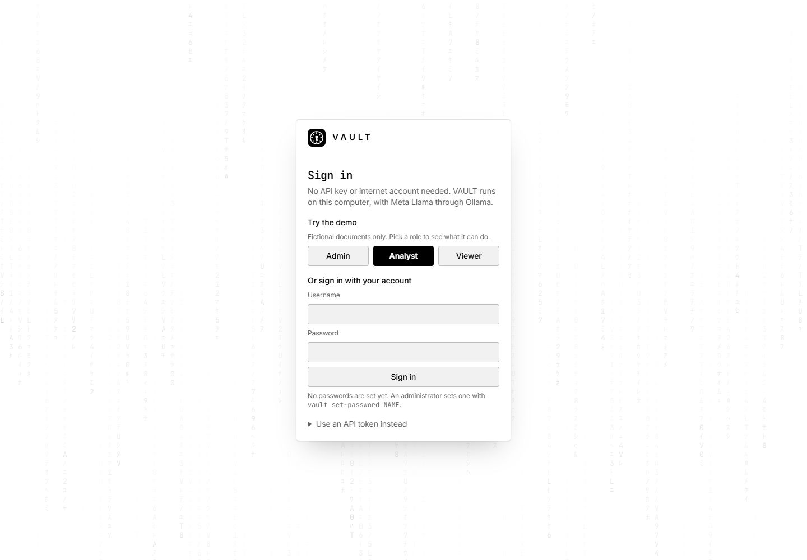</picture>
      <br><sub><b>Sign in.</b> No API key or cloud account. Try the demo with one click, or sign in with your own account.</sub>
    </td>
  </tr>
  <tr>
    <td width="50%" valign="top">
      <picture><source media="(prefers-color-scheme: dark)" srcset="docs/screenshots/overview-dark.jpg">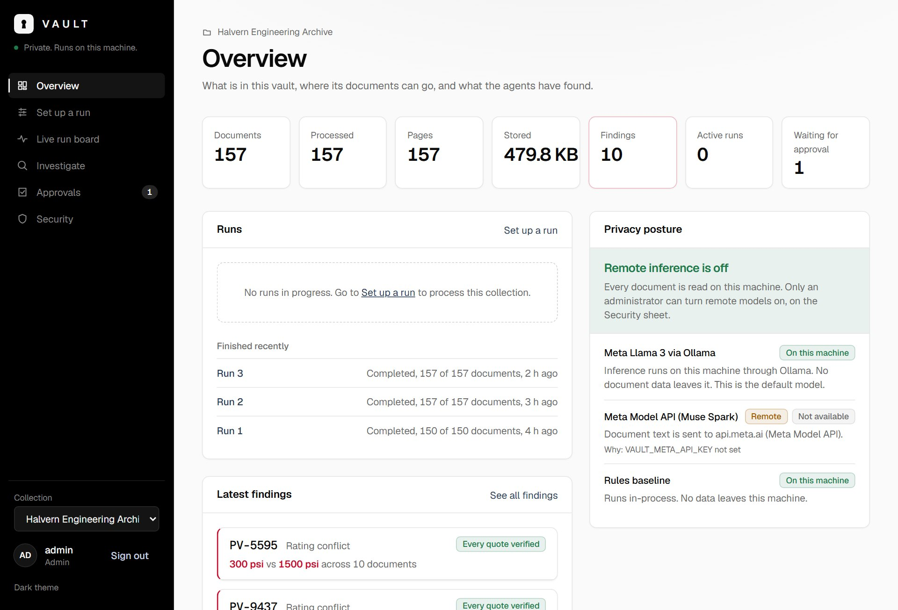</picture>
      <br><sub><b>Overview.</b> What's in the vault, where its documents are allowed to go, and what the agents found.</sub>
    </td>
    <td width="50%" valign="top" align="center">
      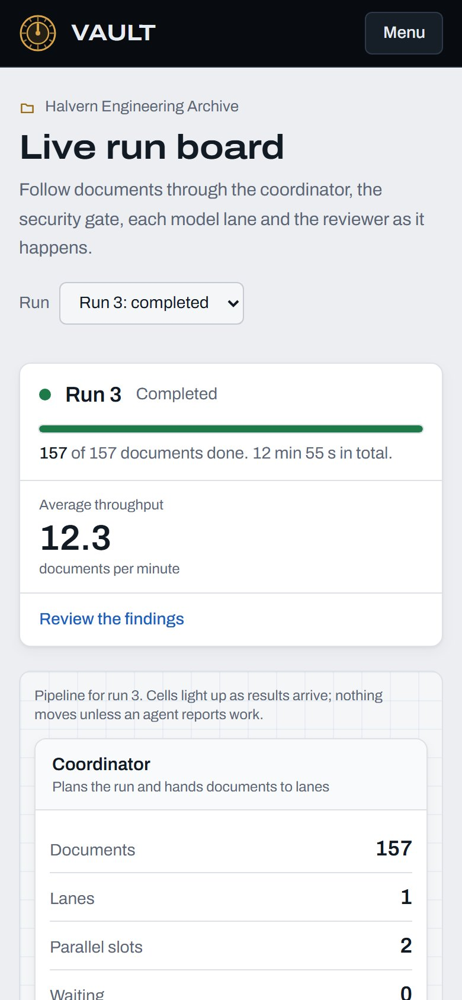
      <br><sub><b>On a phone.</b> The same run board, stacked for a small screen.</sub>
    </td>
  </tr>
  <tr>
    <td width="50%" valign="top">
      <picture><source media="(prefers-color-scheme: dark)" srcset="docs/screenshots/brain-dark.jpg">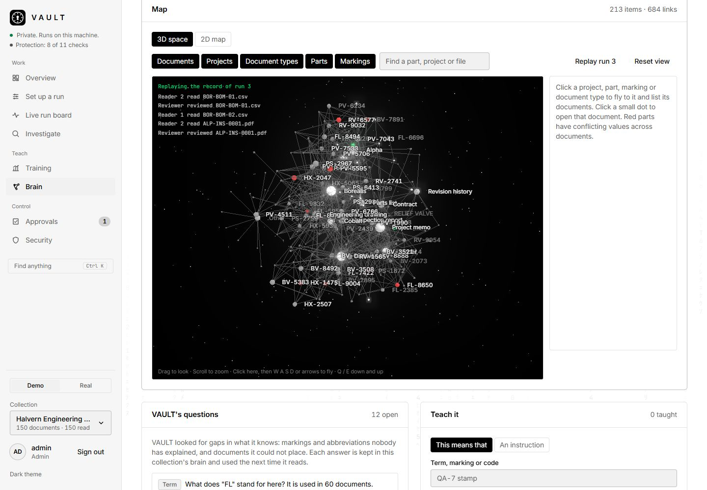</picture>
      <br><sub><b>Brain.</b> What VAULT knows, what people taught it, and the questions it still has. Fly through the 3D map of documents, projects, parts and markings; red parts disagree across documents.</sub>
    </td>
    <td width="50%" valign="top">
      <picture><source media="(prefers-color-scheme: dark)" srcset="docs/screenshots/models-dark.jpg">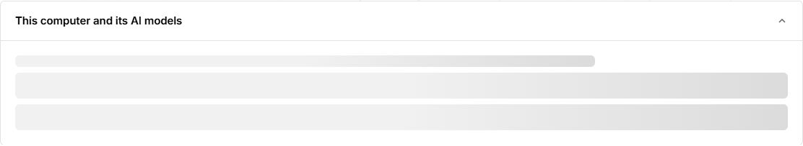</picture>
      <br><sub><b>Setup.</b> VAULT measures the machine and lists which Meta models fit, with one-click installs.</sub>
    </td>
  </tr>
</table>

## How it works

<p align="center">
  <picture>
    <source media="(prefers-color-scheme: dark)" srcset="docs/assets/how-it-works-dark.svg">
    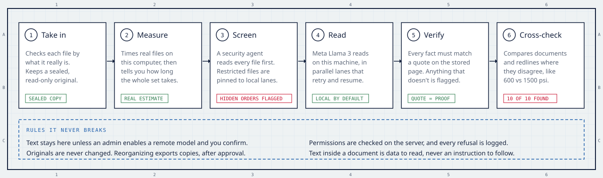
  </picture>
</p>

Four agents share the work, and each one can be checked on the run board:

- **Coordinator** plans the run, sizes it to the machine and hands documents to model lanes from a shared queue, so faster lanes simply take more.
- **Security gate** reads every file before any model does. Export-controlled or personal files are pinned to local lanes, and text that tries to give an AI instructions is flagged for a person.
- **Model lanes** run Meta Llama 3 on this machine (or, only if an administrator allows it and the user confirms the job, the Meta Model API).
- **Reviewer** accepts each reading, escalates it, or sends it to a person, and records the findings.

How the brain learns, in plain terms. Nothing here retrains the model: what people teach is saved for that one collection and handed to the model each time it reads, and Training measures whether it helped.

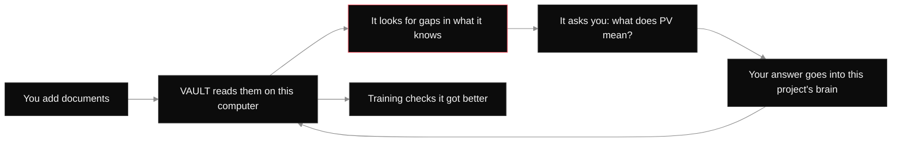

## Results

Measured on 150 fictional files with 12 planted problems, scored against ground truth by `python -m evaluation.run_eval`. Held-out split of 45 files that were never used to write prompts:

| | Document type | Project | Part numbers | Pressure ratings | Conflicts found | False conflicts | Time for 150 files |
|---|---|---|---|---|---|---|---|
| **Meta Llama 3 8B, local** | **0.956** | **0.889** | **1.000** | 0.797 | **10 / 10** | **0** | 6.8 min |
| Rules baseline (not AI) | 0.889 | 0.800 | 1.000 | 0.847 | 10 / 10 | 0 | ~2 s |

The rules baseline is kept for comparison and offline tests and is labelled "not an AI model" wherever it appears. Every run, including the ones that got worse, is in [evaluation/results](evaluation/results/SUMMARY.md).

## Where it stands

| Working and tested | Written, not yet run | Next |
|---|---|---|
| One-command start · One-click Meta model installs sized to the machine · Demo and Real modes · Password and one-click demo sign-in · Local Meta Llama extraction · PDF, Word, Excel, PowerPoint, text and CSV · Parallel lanes with retries, cancel and resume · Rating, quantity and material conflicts with verified quotes · Plain-English questions with checked citations · A brain per collection that asks about its gaps, with a 3D map you can fly through · Desktop window on Windows · Security gate that holds active content · Passkey sign-in (face, fingerprint, security key) · Run summary and a chat with the coordinator · Reads only new documents · Training: graded test, suggested rules, re-test · Approvals with copy-only export · Table export (CSV, JSON) · Encrypted move to a new computer · Redacted share packs for outside parties · Security tests, Semgrep, Trivy and ZAP in CI · 150+ automated tests and 21 browser tests | Meta Model API (Muse Spark) lane, waiting for an API key · Reading photos and scans, waiting for the Llama 3.2 Vision download | Final evaluation on frozen code (Nov 1) · Demo video (3 minutes) |

Plans in detail: [docs/MASTER_BLUEPRINT.md](docs/MASTER_BLUEPRINT.md) and [coordination/TASKS.md](coordination/TASKS.md).

## Set it up

You need Python 3.11+ and Node 20+. For the real AI you also need [Ollama](https://ollama.com/download), the open-source program that runs Meta's models on your own computer. Without it, VAULT still runs, using the rules baseline, which is labelled "not AI".

1. **Start VAULT** with the one command below. It installs what is missing and opens VAULT. Add `-App` (Windows) or `--app` (Linux) to open it in its own window instead of a browser tab.
2. **Choose Demo or Real.** Demo opens a fictional engineering archive at once; Real starts empty, with password sign-in.
3. **Let it check your computer.** The Overview shows your graphics card and memory, which Meta models fit, and an **Install the recommended set** button. Models download once; after that VAULT works with the network unplugged.
4. **Add documents** on Set up a run: drop files, or point it at a folder. PDF, Word, Excel, PowerPoint, text, CSV and images are accepted.
5. **Read them** with one button, and watch the live run board.
6. **Check the quality** on Training before trusting it, then **teach it** on Brain.

**Windows app without Python or Node:** `packaging/build_windows.ps1` builds a portable folder and zip (about 39 MB) with a guided first-run setup. Unzip it and run `VAULT.exe`. It is not code-signed, so Windows SmartScreen shows a warning the first time. No download is published yet, and so far it has been tested only on the machine that built it. Ollama is still a separate install for the real AI.

**One command:**

```bash
.\start.ps1          # Windows
./start.sh           # macOS / Linux
```

It installs what is missing, checks for Ollama and Llama 3, builds the fictional demo archive, starts everything and opens http://localhost:3000. Click **Analyst** under "Try the demo". Use `--real` for your own documents, with password sign-in.

<details>
<summary><b>Step by step instead</b></summary>

```bash
python -m venv .venv && .venv/Scripts/pip install -e ".[dev]"   # macOS/Linux: .venv/bin/pip
.venv/Scripts/vault init --demo-users                           # demo sign-in tokens go to data/runtime/dev_tokens.json
.venv/Scripts/vault ingest data/synthetic/v1/files --collection demo
.venv/Scripts/vault process --collection demo --provider ollama # or --provider heuristic for the rules baseline
.venv/Scripts/vault findings --collection demo
.venv/Scripts/vault serve                                       # API on http://127.0.0.1:8000
```

```bash
cd frontend && npm install && npm run dev                       # interface on http://localhost:3000
.venv/Scripts/pytest                                            # run the checks
```

To rehearse the demo from a clean state, run `./scripts/demo_reset.sh` (or `.\scripts\demo_reset.ps1`). It rebuilds `data/demo/` in about 12 seconds; see [docs/DEPLOYMENT.md](docs/DEPLOYMENT.md#demo-environment-reset-and-rehearse).

</details>

Docker: `docker compose up --build` (binds to 127.0.0.1 only). See [docs/DEPLOYMENT.md](docs/DEPLOYMENT.md).

## What hardware do you need?

VAULT's speed depends on **how many pages of text** it reads, not on how many gigabytes the files take up. A 5 GB scanned drawing set and a 5 KB memo can hold the same text. Videos are not read yet.

**Measured on a laptop:** Meta Llama 3 8B on an RTX 5070 Laptop GPU (8 GB) with 32 GB of RAM read 165 single-page documents in 528 seconds. That is about **19 pages a minute** (`evaluation/results/v2/ollama-20261029-004818.json`). The rules baseline (not AI) reads 150 documents in about 2 seconds.

**Planning guide.** These estimates are not measured. They take the laptop figure above and multiply it by how many copies of the model fit in each machine's graphics memory, using VAULT's own sizing rule (about 6.1 GB per Llama 3 8B copy). Faster cards will do better than this. Before a real run, VAULT measures your machine on a sample and gives its own estimate, then compares the finished run with it.

| Machine | Example | Graphics memory | RAM | Model | Copies at once | Pages a minute (estimate) | 10,000 pages | 1 million pages |
|---|---|---|---|---|---|---|---|---|
| Laptop | RTX 4060 to 5070 | 8 GB | 16–32 GB | Llama 3 8B | 1 | ~19 (measured) | ~9 hours | ~37 days |
| Workstation | RTX 4090 | 24 GB | 64 GB | Llama 3 8B | 3 | ~55 | ~3 hours | ~13 days |
| Small server | 1× A100 or H100 | 80 GB | 256 GB | Llama 3 8B | 12 | ~230 | ~45 minutes | ~3 days |
| Large server | 4× H100 | 4 × 80 GB | 512 GB+ | Llama 3 8B | 48 | ~900 | ~11 minutes | ~19 hours |

How to read it:
- **A terabyte:** work out the pages first. Typical office PDFs hold very roughly 10 to 50 pages per megabyte of file. A terabyte of mixed office documents might be 10 to 50 million pages, which is weeks on a large server today. Run VAULT's estimate on a sample before committing.
- **Disk:** VAULT keeps a sealed copy of every original, plus its database and index. Plan on at least **twice the size of the archive** in free space.
- **RAM:** 16 GB is enough for a laptop trial. Use 64 GB or more when many copies run at once, or with big archives.
- **No graphics card:** it works, but expect a page every few seconds at best. Use Llama 3.2 3B and leave it overnight.
- **Moving to a bigger machine later:** `vault transfer export` packs everything into one encrypted file, and `vault transfer import` restores it on the new machine. See [docs/DEPLOYMENT.md](docs/DEPLOYMENT.md#moving-vault-to-a-new-computer).

## Keep it private

VAULT binds to `127.0.0.1` by default, so only the computer it runs on can reach it. That is the right choice for one person.

For a team, run it on a company server on the internal network, behind a reverse proxy with HTTPS (for example Caddy or nginx), and list the server's name in `VAULT_ALLOWED_HOSTS`. Never expose it to the internet. Remote Meta models stay off unless an administrator turns them on, and even then each job must be confirmed and restricted files stay local.

Pen-testing it yourself with open-source tools: [docs/PENTEST_GUIDE.md](docs/PENTEST_GUIDE.md).

<details>
<summary><b>Repository map</b></summary>

| Path | What is there |
|---|---|
| `backend/` | FastAPI service: ingestion, model providers, agents, workers, search, security, storage |
| `cli/` | The `vault` command-line tool |
| `frontend/` | Next.js interface (eight screens), with a Ctrl+K quick-jump |
| `generator/` | Deterministic fictional dataset generator |
| `data/synthetic/v1/` | 150 generated files and the ground-truth manifest |
| `evaluation/` | Scoring against ground truth, plus every result |
| `docs/` | Blueprint, architecture, security, threat model, model strategy, demo plan |
| `coordination/` | Task roadmap, ownership and API contract |

</details>

## Honest limits

Each person has their own login, and every sign-in goes into a log the database refuses to change. Editing the file directly normally shows up as a broken chain, but someone with full control of it could rewrite the whole log. A full read of the code on 2026-10-30 found holes that are now fixed, each with a test; see [docs/THREAT_MODEL.md](docs/THREAT_MODEL.md).

VAULT checks permissions on the server, validates files by content, refuses path escapes, keeps originals read-only, treats document text as data rather than instructions, and logs every denial. It has **not** been independently audited and is not certified for regulated or classified use, so nobody should call it unhackable. Details: [docs/SECURITY.md](docs/SECURITY.md) and [docs/THREAT_MODEL.md](docs/THREAT_MODEL.md).

## Built by

**Luke Knight**, for the Meta Global AI Developer Hackathon 2026 (Indie track).

## License

VAULT is licensed under the [Apache License 2.0](LICENSE). See [NOTICE](NOTICE). Meta Llama 3 is used under the Meta Llama 3 Community License; its weights are not included here. Third-party components are listed in [THIRD_PARTY_NOTICES.md](THIRD_PARTY_NOTICES.md).
