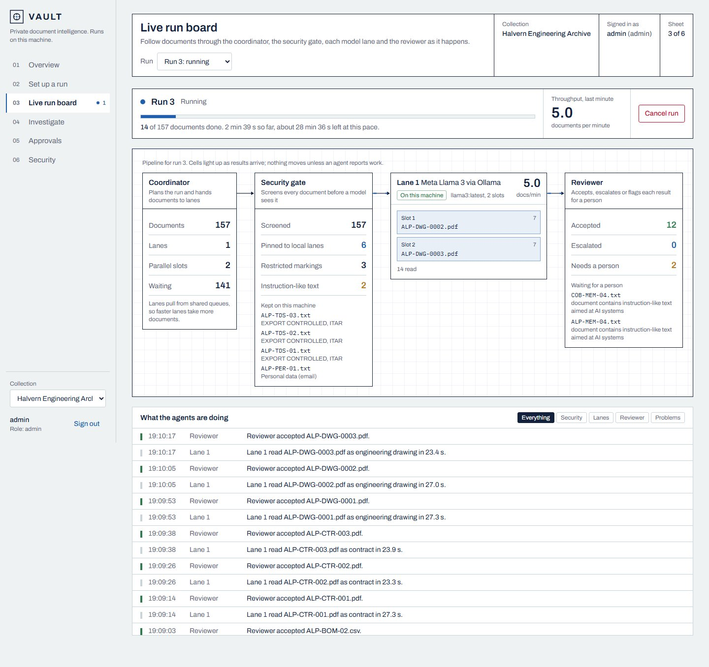
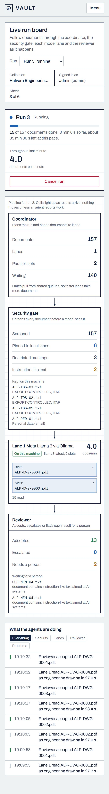
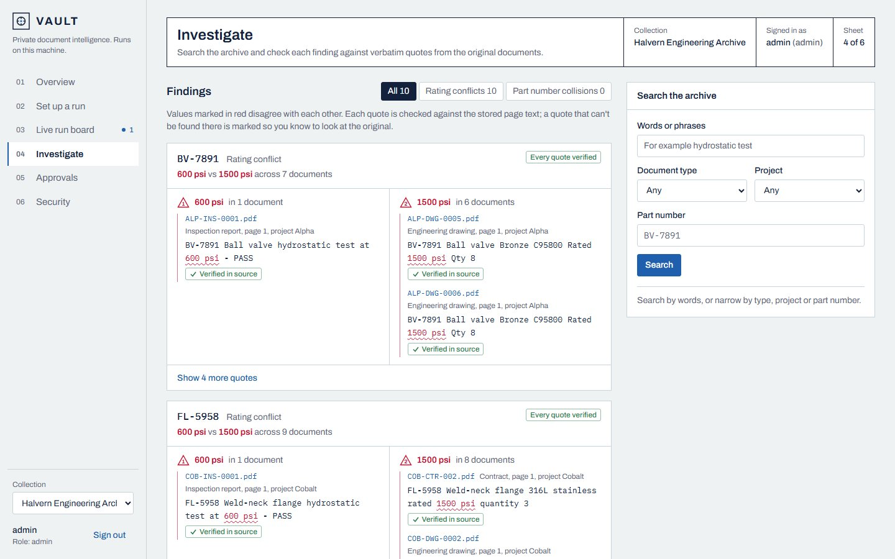
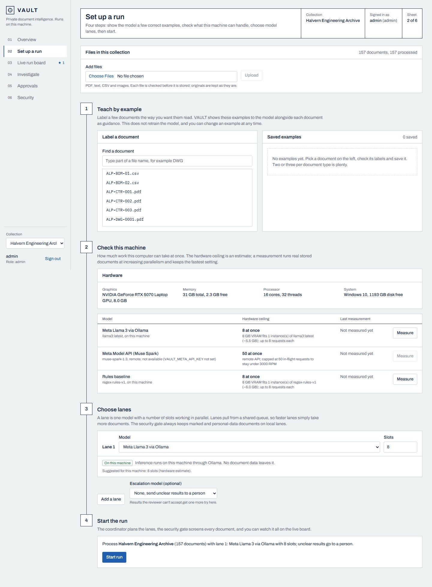
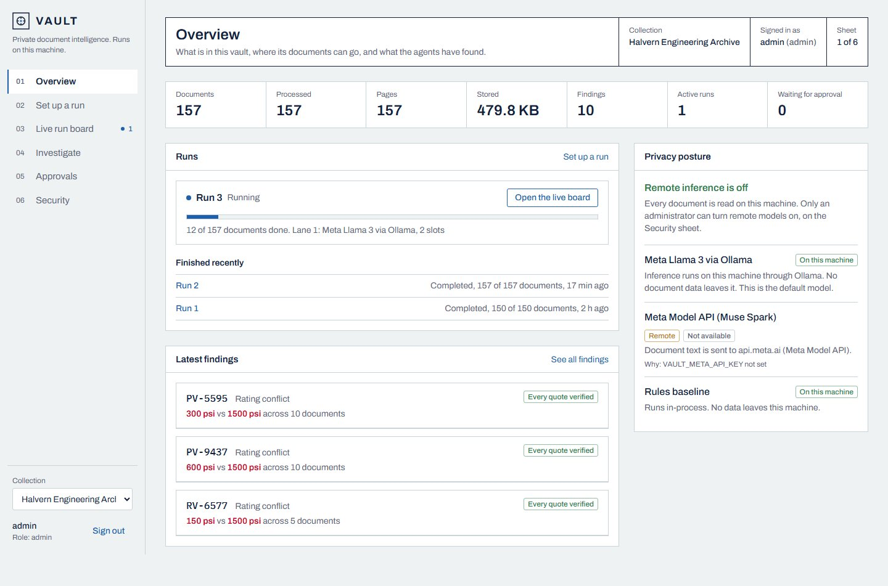
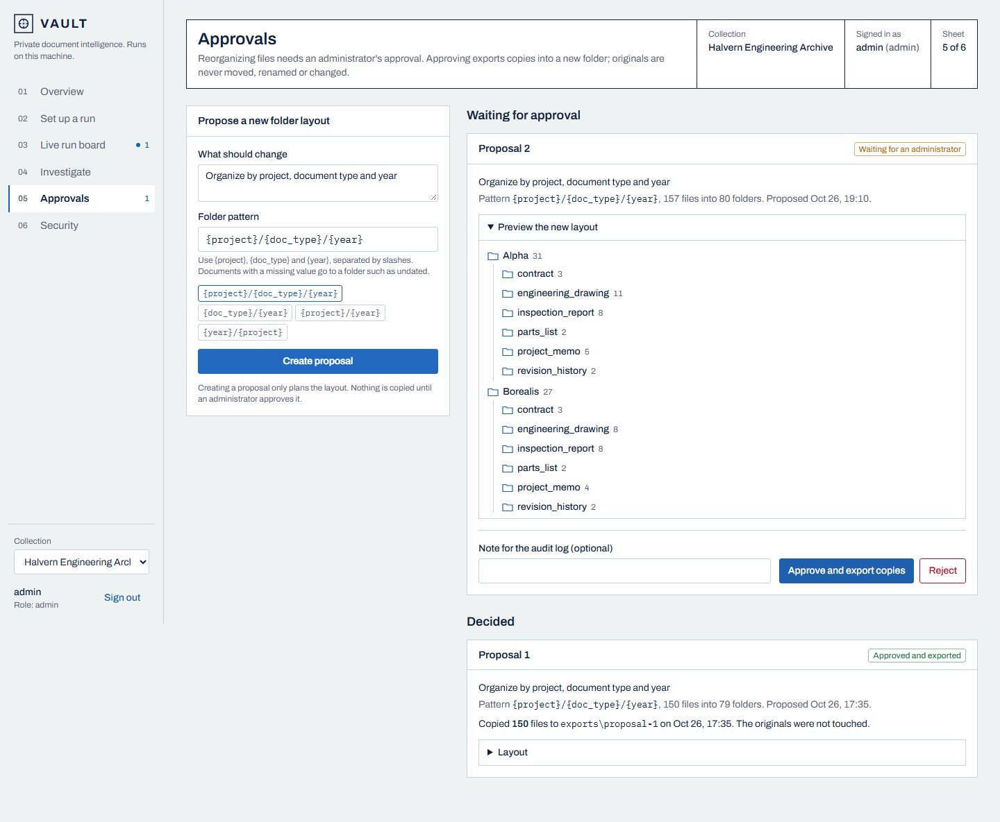
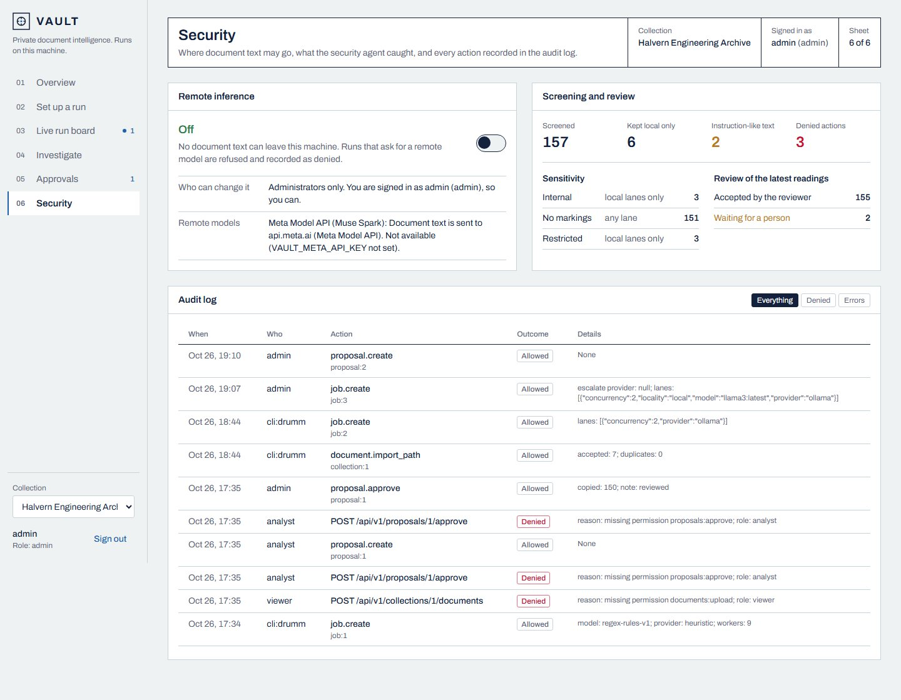
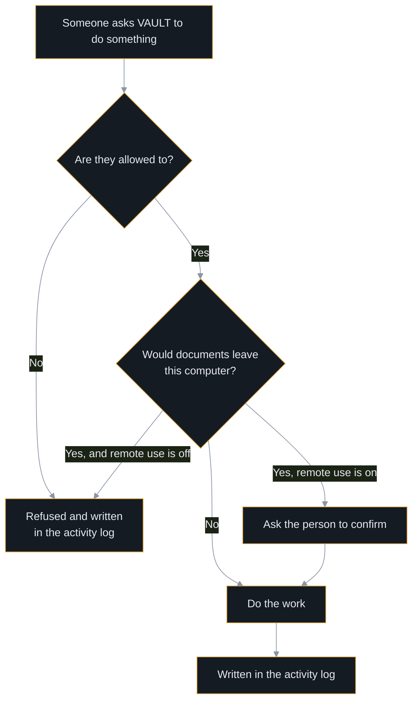

<p align="center">
  
</p>

<p align="center">
  <a href="https://github.com/F0rger123/vault-hackathon-2026/actions/workflows/ci.yml"></a>
  
  
  
  
  
</p>

> **AI agents: start here.** Paste this repository link into Claude or ChatGPT and ask it to walk you through VAULT. Machine-readable entry points:
> [AGENTS.md](https://raw.githubusercontent.com/F0rger123/vault-hackathon-2026/main/AGENTS.md) ·
> [docs/AI_GUIDE.md](https://raw.githubusercontent.com/F0rger123/vault-hackathon-2026/main/docs/AI_GUIDE.md) ·
> [llms.txt](https://raw.githubusercontent.com/F0rger123/vault-hackathon-2026/main/llms.txt)

## What VAULT does

Engineering firms, manufacturers and public agencies sit on huge piles of drawings, inspection reports, contracts and scans. Finding the one document that matters, or noticing that two of them disagree, takes people days.

VAULT runs on the organization's own computer. You point it at a collection of files and it:

- **reads every file** (PDFs, text, spreadsheets as CSV, images) and keeps the originals untouched;
- **uses a Meta model to understand them**: document type, project, dates, part numbers, pressure ratings;
- **checks its own evidence**: every extracted fact links back to an exact quote and page, and quotes that cannot be found in the source are flagged instead of trusted;
- **cross-checks documents against each other**, for example a drawing that rates a valve at 1500 psi while its inspection record says 600 psi;
- **measures your hardware** and benchmarks a real sample before telling you how long a collection will take;
- **proposes reorganizations** that only happen after an administrator approves them, and even then only as copies;
- **records every action**, including the ones it refused.

Document text stays on the machine unless an administrator deliberately turns on a remote model and the user confirms each job.

## Screenshots

All data shown is fictional, produced by the project's own synthetic dataset generator.

| Live run board: coordinator, security gate, model lanes, reviewer | Phone |
|---|---|
|  |  |

| Findings drawn as redlines, every quote checked | Set up a run: teach, check the machine, choose lanes |
|---|---|
|  |  |

| Overview | Approvals | Security and audit |
|---|---|---|
|  |  |  |

## How it works

```mermaid
%%{init: {"theme":"base","themeVariables":{"primaryColor":"#151b23","primaryTextColor":"#e6e9ee","primaryBorderColor":"#5b8cff","lineColor":"#8b95a5","secondaryColor":"#0d1117","tertiaryColor":"#0d1117","fontFamily":"Geist, Segoe UI, sans-serif"}}}%%
flowchart LR
    A["Someone adds a folder of files"] --> B["Files are checked and<br/>a sealed copy is kept"]
    B --> C["Computer checks how fast<br/>it can work and gives an estimate"]
    C --> D["A Meta model reads each file<br/>on this machine"]
    D --> E["Every fact is matched to<br/>a quote in the original"]
    E --> F["Documents are compared<br/>and conflicts are flagged"]
    F --> G["People search, review<br/>and approve changes"]
```





## Current status (October 26, 2026)

Built and tested today, on the first day of the event:

| Area | State | Evidence |
|---|---|---|
| Ingestion, hashing, read-only originals, page text | Working | integration test, 150-file dataset |
| Local Meta model (Llama 3 8B via Ollama) | Working | held-out doc type 0.956, 10/10 conflicts, 6.8 min per 150 docs ([results](evaluation/results/SUMMARY.md)) |
| Meta Model API (Muse Spark) | Code written, not yet run | waiting for an API key |
| Bounded parallel jobs, retries, cancel, resume | Working | integration tests |
| Cross-document conflicts with verified evidence | Working | 10 of 10 planted conflicts found, 0 false (heuristic baseline) |
| Search with filters and page references | Working | integration test |
| Corrections and versioned rules | Working | integration test |
| Approval workflow and copy-only export | Working | integration and security tests |
| Security cases S1–S10 | Passing | `tests/security` |
| Web interface: overview, set-up, live run board, investigate, approvals, security | Working | lint, type check and build pass; checked against the live API |
| Coordinator, security and review agents with parallel model lanes | Working | `tests/integration/test_agents.py`; 3,700-file run |

The heuristic baseline is a rule-based extractor kept for comparison and offline tests. It is labelled "not an AI model" everywhere it appears. Detailed plans live in [docs/MASTER_BLUEPRINT.md](docs/MASTER_BLUEPRINT.md) and [coordination/TASKS.md](coordination/TASKS.md).

## Quick start

Requirements: Python 3.11+, Node 20+, and optionally [Ollama](https://ollama.com) with a Meta model pulled (`ollama pull llama3`).

```bash
python -m venv .venv && .venv/Scripts/pip install -e ".[dev]"   # macOS/Linux: .venv/bin/pip
.venv/Scripts/vault init --demo-users                           # tokens go to data/runtime/dev_tokens.json
.venv/Scripts/vault ingest data/synthetic/v1/files --collection demo
.venv/Scripts/vault process --collection demo --provider ollama # or --provider heuristic for the baseline
.venv/Scripts/vault findings --collection demo
.venv/Scripts/vault serve                                       # API on http://127.0.0.1:8000
```

```bash
cd frontend && npm install && npm run dev                       # dashboard on http://localhost:3000
```

Run the checks:

```bash
.venv/Scripts/pytest
```

Docker: `docker compose up --build` (binds to 127.0.0.1 only). See [docs/DEPLOYMENT.md](docs/DEPLOYMENT.md).

## Repository map

| Path | What is there |
|---|---|
| `backend/` | FastAPI service: ingestion, providers, workers, search, security, storage |
| `cli/` | `vault` command-line tool |
| `generator/` | Deterministic fictional dataset generator |
| `data/synthetic/v1/` | 150 generated files and the ground-truth manifest |
| `evaluation/` | Scoring against ground truth |
| `frontend/` | Next.js dashboard |
| `docs/` | Blueprint, architecture, security, model strategy, demo plan |
| `coordination/` | Task roadmap, ownership, API contract, handoffs |

## Security and honesty

VAULT enforces permissions on the server, validates files by content, refuses path escapes, keeps originals read-only, treats document text as data rather than instructions, and logs denials. It has not been independently audited, is not certified for any regulated or classified use, and nobody should describe it as unhackable. See [docs/SECURITY.md](docs/SECURITY.md) and [docs/THREAT_MODEL.md](docs/THREAT_MODEL.md).

## Team

Built by Luke and Franco for the Meta Global AI Developer Hackathon 2026 (Indie track).

## License

No license has been chosen yet. Until one is added, the code is public to read but all rights are reserved. Third-party components are listed in [THIRD_PARTY_NOTICES.md](THIRD_PARTY_NOTICES.md).
