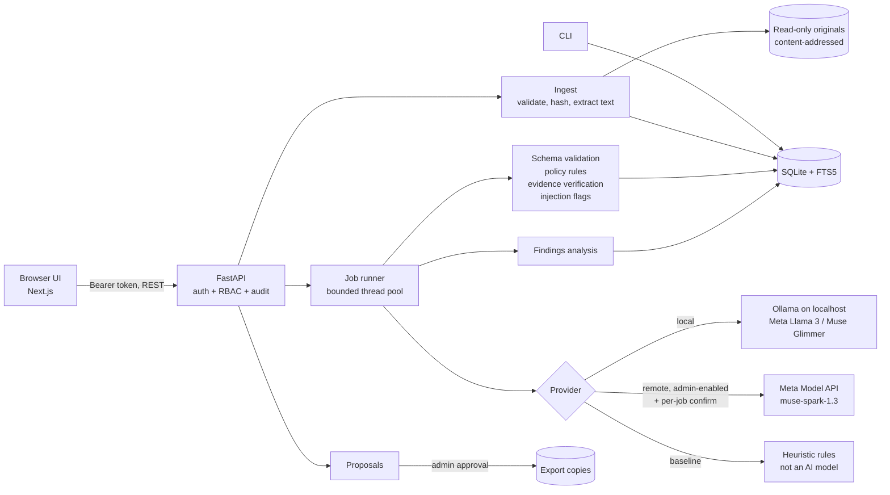

# VAULT Architecture

## Overview

VAULT runs as one backend process and one frontend process. Both run on the customer's machine.

- **Backend.** A FastAPI app that owns the SQLite database, the stored originals, and the job workers. Workers run as threads inside this process.
- **Frontend.** A Next.js client. It talks to the backend only through the REST API under `/api/v1`.
- **CLI.** Works directly on the same database and storage.
- **Model inference.** Runs either locally, through Ollama on localhost, or remotely, through the Meta Model API. The remote route works only after an admin enables it.



## Module map

| Path | Responsibility |
|---|---|
| `backend/main.py` | App factory, CORS, security headers, generic 500 handler, job resume |
| `backend/api/routes.py` | All `/api/v1` endpoints; each one declares a permission |
| `backend/api/deps.py` | DB connection per request, token auth, `require(permission)` with denial audit |
| `backend/api/schemas.py` | Pydantic request bodies |
| `backend/core/config.py` | `VAULT_*` settings |
| `backend/core/runtime.py` | Admin overrides stored in the DB, layered over the env settings |
| `backend/core/hardware.py` | Hardware profile, worker recommendation, runtime estimate |
| `backend/storage/db.py` | Connections, transactions, migrations |
| `backend/security/` | `auth.py` (roles, tokens), `files.py` (validation, containment), `audit.py` |
| `backend/ingest/service.py` | Validation, hashing, original storage, page extraction |
| `backend/providers/` | Provider interface, Ollama and Meta API providers, heuristic baseline, prompt construction, schema |
| `backend/workers/` | `processing.py` (one document), `jobs.py` (runner), `proposals.py` |
| `backend/indexing/` | `search.py` (FTS5 plus filters), `findings.py` (conflict analysis) |
| `cli/main.py` | Typer CLI |
| `generator/generate.py` | Synthetic dataset generator |
| `evaluation/run_eval.py` | Scores extractions against the ground truth |
| `frontend/src/lib/api.ts` | Typed API client |

## Processing sequence

```mermaid
sequenceDiagram
    participant A as Analyst
    participant API
    participant R as JobRunner
    participant M as Provider (Meta model)
    participant DB
    A->>API: POST /jobs {collection_id, provider}
    API->>API: permission jobs:create; remote gate
    API->>DB: insert job + items
    API->>R: start(job_id)
    loop each document (N workers)
        R->>DB: load page text
        R->>M: system prompt + fenced document text
        M-->>R: JSON (schema-constrained)
        R->>R: validate, apply policy, verify quotes, flag injection
        R->>DB: insert extraction, update progress
    end
    R->>DB: analyse_collection → findings
    A->>API: GET /jobs/{id}, /collections/{id}/findings
```

## Key design choices

- **Single process.** Worker threads share the process with the API, and job state is kept in the database. We can move to a separate worker service later without changing the database schema.
- **Concurrency.** SQLite runs in WAL mode. Each worker has its own connection with a 10 s busy timeout, and transactions are kept short.
- **Latest-extraction semantics.** Every run appends a new extraction. Search, findings and proposals read the latest one for each document, so history is kept for audit and evaluation.
- **Models extract facts; code compares them.** Conflict detection is deterministic over the extracted facts, which makes it testable.
- **No action surface for models.** Nothing a model returns is ever executed. A model's output is only parsed into a fixed schema.

## Configuration

All settings use the `VAULT_*` prefix; see `.env.example`. The important ones:

- `VAULT_PROVIDER`
- `VAULT_OLLAMA_MODEL`
- `VAULT_META_API_KEY`
- `VAULT_ALLOW_REMOTE_INFERENCE`
- `VAULT_IMPORT_ROOTS`
- `VAULT_MAX_UPLOAD_MB`

## Scaling path

This is not built yet; see `LONG_TERM_ROADMAP.md`.

- Replace SQLite with PostgreSQL.
- Move workers onto a queue such as Redis Streams or NATS.
- Move originals to S3-compatible object storage.
- Use a dedicated search index once the collection outgrows FTS5.
