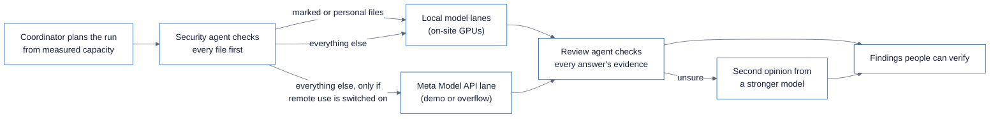

# Scaling and demo strategy

This page answers two questions with measured numbers: can local Meta models handle thousands of documents,
and how should the demo video show VAULT at scale without misrepresenting what a laptop can do.

## What was measured (2026-10-26, Luke's laptop)

Machine: Windows 11, NVIDIA RTX 5070 Laptop GPU (8 GB VRAM), 31 GB RAM, 32 logical cores.

| Measurement | Result | Source |
|---|---|---|
| Local Llama 3 8B (`llama3:latest`, Ollama 0.32.1), throughput vs parallel requests | 1 slot: 9.5 docs/min; **2 slots: 12.8 docs/min**; 4 slots: 12.5 docs/min (no gain) | `evaluation/results/capacity-ollama-*.json` |
| Full 150-document run, 2 slots, prompt v3 | 6.8 minutes; held-out doc type 0.956; 10/10 planted conflicts, 0 false | `evaluation/results/SUMMARY.md` |
| VAULT pipeline without a model (heuristic lanes, 16 slots), 3,700 files | ~15 seconds; 200/200 planted conflicts, 0 false, 6 cross-project part-number collisions | scale run, commit `9957ede` |
| Tokens per document (Llama 3 tokenizer) | median 561 input, 239 output | measured on 8 dataset files |

What this means: the orchestration, storage and search layers are not the bottleneck. The model is.
One 8 GB laptop GPU runs one Llama 3 8B instance, which saturates at about 13 documents per minute.

| Collection size | Local Llama 3 8B on this laptop (12.8 docs/min) |
|---|---|
| 150 (demo dataset) | ~12 minutes |
| 1,000 | ~1.3 hours |
| 10,000 | ~13 hours |
| 1,000,000 | ~54 days |

## How VAULT scales

The coordinator agent treats every model endpoint as a **lane** with a number of slots, and lanes pull
from shared queues, so adding hardware adds throughput without code changes:

- **Capacity planning is measured.** `vault calibrate` (or `POST /system/capacity/calibrate`) sends the same
  sample at 1, 2, 4, 8... parallel requests and keeps the level where throughput stops improving by 10%.
  A static ceiling from VRAM and model size (for example 80 GB fits four 18 GB Muse Glimmer instances) caps
  the search.
- **Multiple lanes run at once** (`--lane ollama:2 --lane ollama-gpu2:2`, or several machines' Ollama
  servers in a future release). A customer with many GPU servers adds lanes; the coordinator spreads work.
- **Sensitive documents never reach a remote lane.** The security agent pins anything with export-control,
  classification-style or personal-data markings to local lanes. In tests, a run with only a remote lane
  blocks those files instead of sending them (`tests/integration/test_agents.py`).
- **Review and escalation** keep quality up when a small, fast model is used for the bulk pass: only
  documents the review agent doubts go to a slower, stronger model.

Not built yet (documented in `docs/LONG_TERM_ROADMAP.md`): lanes on other machines, GPU scheduling across
nodes, OCR and vision for photos on local hardware.

## Recommendation for the demo video

Use a **hybrid** demo and say exactly what is happening on screen:

1. **Local, live, small:** run the 150-file dataset on the laptop with local Llama 3 (about 7 minutes; speed
   up the recording and show the real clock). This proves the private path works with no network.
2. **Remote, large, fictional only:** run a 3,000+ file synthetic collection through a Meta Model API lane
   (Muse Spark) next to the local lane. The board shows the security agent pinning ITAR-marked files to the
   local lane while the remote lane takes the bulk. Narrate: "This laptop can run one model at 13 documents a
   minute. A customer's on-site GPU servers add lanes the same way; for this demo the extra lanes are Meta's
   hosted model, used only for fictional data."
3. **Never** imply the laptop processed the large set locally, and never show the remote lane receiving real
   or marked documents.

Estimated Meta Model API cost (unverified until a key is created; Muse Spark list price $1.25 per million
input tokens, $4.25 per million output, `docs/MODEL_STRATEGY.md`): about 600–1,000 input and 250–300 output
tokens per text document gives roughly **$0.002–0.003 per document**, so about $3 per 1,000 documents and
$26 per 10,000. Photos cost more because images are larger inputs. Throughput depends on response latency
and the 3,000 requests-per-minute team limit; it has not been measured.

## What needs Luke

- Create a Meta Model API key and confirm whether event credits apply (blocker B2).
- Approve spending for one calibration run and one 3,000-file demo run (estimated under $15).
- Decide whether to download a vision-capable local model for photos (`llama3.2-vision`, ~8 GB, tight on
  8 GB VRAM) or use Muse Spark for photos in the demo only.
